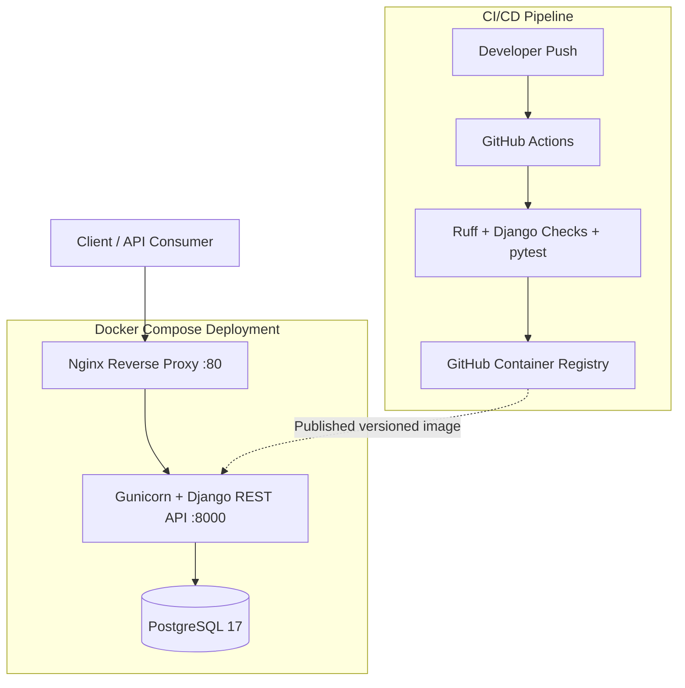

# Hotel Reservation Service

A containerized hotel reservation API built with Django REST Framework and PostgreSQL. The project demonstrates reliable room booking, database-level concurrency protection, Docker-based deployment, CI/CD image publishing, health monitoring, security scanning, and database recovery.

## 1. Project Overview

The service supports room availability searches and reservation creation.

Its main reliability requirement is that two concurrent requests must not create overlapping confirmed reservations for the same physical room.

The application uses PostgreSQL constraints and transaction-level room locking to protect reservation integrity.

## 2. Architecture

### Application request flow



### CI/CD flow

```text
Developer pushes code
        |
        v
GitHub Actions
        |
        +--> Ruff checks
        +--> Django system checks
        +--> pytest
        |
        v
Docker image build
        |
        v
GitHub Container Registry (GHCR)
        |
        v
Docker Compose deployment
```

## 3. Technology Stack

- Python 3.13
- Django 5.2 and Django REST Framework
- PostgreSQL 17
- Docker and Docker Compose
- Gunicorn
- Nginx
- GitHub Actions
- GitHub Container Registry
- pytest and pytest-django
- Ruff
- Trivy

## 4. Features

- Room availability search by date range and room type
- Reservation creation using a physical room ID
- UUID reservation references
- Validation that check-out is after check-in
- Prevention of overlapping confirmed reservations
- PostgreSQL date-range exclusion constraint
- Transaction-based room locking with `select_for_update()`
- Repeatable room seed command
- Liveness and readiness endpoints
- Structured application logs
- PostgreSQL persistent storage
- Docker health checks
- Database backup and restore procedure

### Reservation concurrency protection

The service uses half-open reservation date ranges: check-in is inclusive and check-out is exclusive.

Two reservations overlap when:

```text
existing.check_in < requested.check_out
AND
existing.check_out > requested.check_in
```

The application locks the physical room row during reservation creation. PostgreSQL also enforces an exclusion constraint that prevents overlapping confirmed reservations for the same room, providing a database-level integrity guarantee.

## 5. Prerequisites

- Git
- Docker Desktop with Docker Compose
- PowerShell (examples below use PowerShell)
- Python 3.13 if running tests outside Docker

## 6. Configuration

Clone the repository:

```powershell
git clone https://github.com/VikhyatSaini/hotel-reservation-service.git
cd hotel-reservation-service
```

Create a local environment file:

```powershell
Copy-Item .env.example .env
```

Edit `.env` and set your own values:

```text
POSTGRES_DB=hotel_db
POSTGRES_USER=hotel_app
POSTGRES_PASSWORD=replace-with-a-strong-local-password
POSTGRES_PORT=5432
DJANGO_SECRET_KEY=replace-with-a-long-random-secret
```

Never commit `.env` or real credentials. The repository includes `.env.example` as a configuration template.

### Local HTTPS certificate

The local Nginx deployment uses a self-signed TLS certificate for `localhost`.

Generate the certificate directory:

```powershell
New-Item -ItemType Directory -Force -Path .\nginx\certs
```

Generate a local certificate and private key using OpenSSL in a temporary Alpine container:

```powershell
docker run --rm `
  -v "${PWD}/nginx/certs:/certs" `
  alpine:latest sh -c "apk add --no-cache openssl && openssl req -x509 -nodes -days 365 -newkey rsa:2048 -keyout /certs/localhost.key -out /certs/localhost.crt -subj '/CN=localhost' -addext 'subjectAltName=DNS:localhost,IP:127.0.0.1'"
```

The certificate and private key are mounted read-only into Nginx. The `nginx/certs/` directory is excluded from Git.

Start the services:

```powershell
docker compose up -d
```

Test HTTPS locally:

```powershell
curl.exe -k -i https://localhost/health/ready/
```

The `-k` option is needed because the certificate is self-signed and is not issued by a publicly trusted certificate authority.

HTTP requests are redirected to HTTPS. This local certificate is for demonstration and development only, not public production use.

## 7. Run the Application

The Compose configuration uses a versioned image published to GHCR.

Pull the application image:

```powershell
docker compose pull
```

Start the services:

```powershell
docker compose up -d
```

Apply database migrations:

```powershell
docker compose exec web python manage.py migrate
```

Create sample rooms:

```powershell
docker compose exec web python manage.py seed_data
```

Check service status:

```powershell
docker compose ps
```

Check application readiness:

```powershell
curl.exe -i http://localhost/health/ready/
```

Expected response:

```json
{
  "status": "ready",
  "database": "connected"
}
```

The application is exposed through Nginx at `http://localhost`.

## 8. API Endpoints

### Liveness

```http
GET /health/live/
```

Successful response: HTTP 200

```json
{
  "status": "alive"
}
```

### Readiness

```http
GET /health/ready/
```

Successful response: HTTP 200

```json
{
  "status": "ready",
  "database": "connected"
}
```

If the database check fails, the endpoint returns HTTP 503.

### Room availability

```http
GET /rooms/availability/?check_in=2027-01-20&check_out=2027-01-22&room_type=STANDARD
```

Query parameters:

| Parameter | Description |
|---|---|
| `check_in` | Arrival date in YYYY-MM-DD format |
| `check_out` | Departure date in YYYY-MM-DD format |
| `room_type` | STANDARD, DELUXE, or SUITE |

Example response:

```json
[
  {
    "room_number": "101",
    "room_type": "STANDARD"
  },
  {
    "room_number": "102",
    "room_type": "STANDARD"
  }
]
```

Only active rooms without overlapping confirmed reservations are returned.

### Create a reservation

```http
POST /reservations/
Content-Type: application/json
```

Example request:

```json
{
  "guest_name": "Alex Morgan",
  "room_id": 1,
  "check_in": "2027-01-20",
  "check_out": "2027-01-22"
}
```

Successful response: HTTP 201

```json
{
  "reference": "generated-uuid",
  "guest_name": "Alex Morgan",
  "room_id": 1,
  "check_in": "2027-01-20",
  "check_out": "2027-01-22",
  "status": "CONFIRMED"
}
```

If the room is unavailable for the requested dates, the API returns HTTP 409:

```json
{
  "error": "Room is not available for these dates."
}
```

### Room list placeholder

```http
GET /rooms/
```

This currently returns a basic API status message and an empty rooms array. Availability searches should use `/rooms/availability/`.

## 9. Tests and Code Quality

Install development dependencies in a local Python virtual environment:

```powershell
python -m venv venv
.\venv\Scripts\Activate.ps1
pip install -r requirements-dev.txt
```

Run formatting and lint checks:

```powershell
ruff check .
ruff format --check .
```

Run Django checks:

```powershell
python manage.py check
```

Run automated tests:

```powershell
pytest
```

The automated tests cover reservation creation, overlapping reservation conflicts, concurrent reservation attempts, and health endpoints.

The concurrency test verifies that two simultaneous requests for the same room and overlapping dates result in exactly one successful reservation and one conflict.

## 10. CI/CD and Image Publishing

GitHub Actions runs on pushes to the main branch and pull requests targeting main.

The workflow performs:

- Dependency installation
- Ruff lint checks
- Ruff formatting checks
- Django system checks
- Automated pytest tests
- Docker image build and publishing to GHCR

The published image uses a commit-based tag so a deployment can identify the source revision.

Current tested deployment image:

```text
ghcr.io/vikhyatsaini/hotel-reservation-service:sha-cdbd098
```

The deployment was verified using this image. Its image digest was:

```text
sha256:3cd0d23d3ee5bc00b4516e3474658ff704e93c011457c6580d2dceec6b2d1aeb
```

## 11. Security

Security measures implemented:

- Django secret key supplied through environment configuration
- `.env` excluded from Git
- Non-root application user in the Docker image
- Runtime and development dependencies separated
- PostgreSQL exposed only on the local host interface
- Application port exposed internally to the Compose network
- Nginx configuration mounted read-only
- Docker health checks
- Trivy image and configuration scanning

### Trivy scan results

The latest recorded image scan found:

- 0 CRITICAL vulnerabilities
- 47 HIGH operating-system package findings
- 0 reported Python runtime dependency vulnerabilities

The remaining HIGH findings were in Debian operating-system packages. Some findings did not have an available fix or were marked as deferred.

Scan reports and the image SBOM are included in the repository:

- `trivy-report.json`
- `trivy-packages.json`
- `hotel-image-sbom.json`

These results describe the image at the time of scanning. They should be refreshed when the base image or dependencies are updated.

## 12. Health Checks and Troubleshooting

### Check service status

```powershell
docker compose ps
```

### View application logs

```powershell
docker compose logs --tail=100 web
```

### View all service logs

```powershell
docker compose logs --tail=100
```

### Restart application recovery test

The application recovery procedure was tested:

1. Stop Django:

   ```powershell
   docker compose stop web
   ```

2. Verify the application becomes unavailable through Nginx.

3. Restart Django:

   ```powershell
   docker compose start web
   ```

4. Check container health:

   ```powershell
   docker compose ps
   ```

5. Verify readiness:

   ```powershell
   curl.exe -i http://localhost/health/ready/
   ```

**Result:** The application recovered and readiness returned HTTP 200 with the database connected. The PostgreSQL container and its persistent data were retained.

### Database recovery

If the database container is stopped:

```powershell
docker compose start db
docker compose ps
```

Check readiness after PostgreSQL becomes healthy:

```powershell
curl.exe -i http://localhost/health/ready/
```

## 13. Database Backup and Restore

### Create a backup

Create a local backup directory:

```powershell
New-Item -ItemType Directory -Force -Path .\backups
```

Create a PostgreSQL custom-format backup:

```powershell
docker exec hotel-postgres pg_dump -U hotel_app -d hotel_db -Fc -f /tmp/hotel_backup.dump
```

Copy the archive to the host:

```powershell
docker cp hotel-postgres:/tmp/hotel_backup.dump .\backups\hotel_backup.dump
```

Inspect the backup archive:

```powershell
docker exec hotel-postgres pg_restore -l /tmp/hotel_backup.dump
```

### Restore into a separate test database

Create a separate database:

```powershell
docker exec hotel-postgres createdb -U hotel_app hotel_restore_test
```

Restore the archive:

```powershell
docker exec hotel-postgres pg_restore -U hotel_app -d hotel_restore_test --no-owner /tmp/hotel_backup.dump
```

Verify the restored tables and records using `psql`.

The restore test verified:

- 12 restored tables
- 5 room records
- 5 reservation records
- `valid_reservation_date_range` check constraint
- `prevent_overlapping_confirmed_reservations` exclusion constraint
- `btree_gist` extension

The original database remained untouched during this restore test.

**Result:** The custom-format PostgreSQL backup was successfully restored into a separate database, and the important reservation integrity objects were verified.

## 14. Rollback and Version Recovery

The application is deployed using a commit-based GHCR image tag. This makes it possible to select a specific previously published application version.

Before switching versions:

1. Identify a previously tested image tag.
2. Confirm that it supports the current database schema and health endpoints.
3. Update the `web.image` value in `docker-compose.yml`.
4. Recreate the application container:

   ```powershell
   docker compose pull web
   docker compose up -d --no-deps --force-recreate web
   ```

5. Verify the container and readiness endpoint:

   ```powershell
   docker compose ps
   curl.exe -i http://localhost/health/ready/
   ```

A previous image was tested during the rollback experiment but did not provide the current health endpoint, so that attempt was not considered a successful rollback. The application was returned to the tested `sha-cdbd098` image, and readiness was verified successfully.

A rollback should only be considered successful after application and database compatibility, container health, and API behavior have been verified.

## 15. Evidence and Project Limitations

Evidence included in the project and development records covers:

- GitHub Actions CI execution
- GHCR image publishing and image pull
- Docker Compose deployment
- Healthy application and database containers
- Liveness and readiness endpoint responses
- Structured application logs
- Concurrent reservation test
- Trivy image and configuration scanning
- PostgreSQL backup archive inspection
- Restore into a separate database
- Application stop and restart recovery

### Known limitations

- The current deployment is a local Docker Compose deployment behind Nginx.
- HTTPS termination and public VM deployment are not demonstrated in this local setup.
- The latest recorded Trivy scan still contains HIGH operating-system package findings.
- The older image used in the rollback experiment was incompatible with the current health endpoint, so a successful rollback to that image was not demonstrated.
- `GET /rooms/` is currently a placeholder; room availability is provided by the availability endpoint.

## 16. Repository

GitHub repository:

https://github.com/VikhyatSaini/hotel-reservation-service